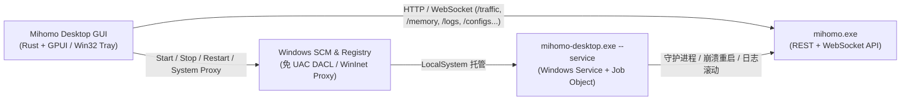

<div align="center">
  
  <h1>Mihomo Desktop</h1>
  <p>基于 <strong>Rust + GPUI (<code>gpui-kit</code>)</strong> 构建的原生 GPU 加速 Windows 桌面代理管理客户端，面向以 <strong>Windows Service</strong> 方式运行的 <code>mihomo</code> (Clash Meta) 核心。</p>

  <p>
    <a href="https://github.com/arloor/mihomo-desktop/actions/workflows/ci.yml">
      
    </a>
    <a href="https://github.com/arloor/mihomo-desktop/releases">
      
    </a>
    <a href="LICENSE">
      
    </a>
    
    
  </p>
</div>

## 为什么选择 Mihomo Desktop

- **原生轻量高性能**：纯 Rust + GPUI GPU 加速渲染，无 Electron / Chromium 内存开销。
- **内置原生 Windows Service 宿主（无需 WinSW）**：单一可执行文件同时承担桌面 UI 与 Windows Service 托管职责，通过 Windows Job Object 防止孤儿进程、崩溃 5 秒自动重启、日志 10MB 自动滚动。
- **日常操作免弹 UAC**：安装服务时自动配置服务 DACL 与 `ProgramData\Mihomo` 目录 ACL，普通权限下即可完成服务启停、配置切换、热重载与 TUN 模式开关。
- **开箱即用**：安装包内置最新 `mihomo.exe` 核心与 GeoIP / GeoSite / MMDB / ASN 数据库，支持离线冷启动。

## 架构概览



## 核心功能

1. **Windows Service 生命周期管理 (`src/system/service.rs`, `src/system/service_host.rs`)**
   - 直接调用 Windows Service Control Manager (SCM) API 查询服务状态、PID、启动类型与二进制路径。
   - 支持一键 **启动 / 停止 / 重启** `mihomo` Windows 服务；优先直接调用 SCM API 免 UAC 执行，仅在权限不足时按需通过单次 UAC 提权执行。
   - 通过内置 `--service` 宿主运行 `mihomo` 服务，并可从 SCM 启动命令行自动同步核心路径、工作目录和生效配置文件路径。
2. **系统代理、托盘与开机自启 (`src/system/proxy.rs`, `src/system/tray.rs`, `src/system/autostart.rs`)**
   - 通过 Windows 注册表（`Internet Settings`）及 WinInet `InternetSetOptionW` 实时开关并刷新系统代理，支持自定义绕过列表（`ProxyOverride`）。
   - Surge 风格三态系统代理检测（未接管 / 接管并生效 / 接管但未生效），动态绘制彩色状态托盘图标并支持右键快捷菜单。
   - 通过 `HKCU\Software\Microsoft\Windows\CurrentVersion\Run` 管理桌面应用静默开机自启（`--minimized`）。
3. **URL 配置导入与多配置管理 (`src/config/mod.rs`)**
   - 支持从远程订阅 URL 导入配置（自动解析 `Subscription-Userinfo` 流量配额与到期时间），支持一键更新、本地 YAML 导入及同步当前服务配置。
4. **TUN 模式与默认配置智能补全**
   - 一键开启/关闭 TUN 模式，自动合并配置并调用 `PUT /configs?force=true` 热重载。
   - 当用户配置文件未提供 `dns`、`tun`、`sniffer` 或 `geox-url` 等字段时，自动补全合理默认值；支持预览合并后的运行时 YAML，并可选开启「强制覆盖原配置 TUN/DNS」。
5. **代理切换、外部资源、连接管理与核心管理**
   - **代理切换**：展示所有策略组与节点卡片，支持节点切换、单节点/全组延迟测速、延迟/名称排序与搜索、`URLTest`/`Fallback` 取消固定。
   - **外部资源**：查看与刷新 `proxy-providers`（含健康检查）、`rule-providers` 及搜索全部分流规则（`/rules`）。
   - **连接管理**：实时查看活跃连接、上下行流量、进程与规则链路，支持搜索、排序、暂停刷新、断开单条或全部连接。
   - **核心管理 (`src/system/core_manager.rs`)**：从 GitHub (`MetaCubeX/mihomo`) 拉取 Release 列表（支持走本地代理及筛选预发布版本），按架构下载解压 Windows 构建包，一键切换版本（自动停止服务 → 备份替换 `mihomo.exe` → 重启服务）。
6. **Mihomo 全量核心管理接口与实时日志 (`src/mihomo/mod.rs`, `src/runtime.rs`)**
   - WebSocket 实时流：`/traffic`（60 秒速率趋势图）、`/memory`、`/logs`（支持级别切换、过滤、暂停与清空）。
   - 管理接口控制台：`PUT /configs?force=true`、`POST /configs/geo`、`POST /cache/fakeip/flush`、`POST /cache/dns/flush`、`POST /restart`、`POST /upgrade`、`POST /upgrade/ui`、`PATCH /configs` 以及交互式 `GET /dns/query` 查询工具。

## 下载与安装

前往 [GitHub Releases](https://github.com/arloor/mihomo-desktop/releases) 下载最新版本：

- **安装版（推荐）**：`MihomoDesktop-Setup-<version>-x64.exe` — 一键安装桌面端、内置 `mihomo` 核心、GEO 数据库并注册 Windows Service。
- **便携打包版**：`MihomoDesktop-<version>-x64-portable.zip` — 解压后右键运行 `Install.cmd` 即可完成服务注册与部署。

## 从源码构建与打包

### 环境要求

- Windows 10 / 11 (x64)
- Rust 工具链（支持 Edition 2024，即 Rust 1.85+）
- 可选：[Inno Setup 6](https://jrsoftware.org/isinfo.php)（`winget install JRSoftware.InnoSetup`），用于生成单文件安装程序

### 构建命令

```powershell
# 开发模式运行
cargo run

# 运行单元测试
cargo test

# 一键构建发布版、自动拉取最新 mihomo 核心与 GEO 数据并打包安装程序 + 便携压缩包
.\scripts\build-installer.ps1 -DownloadCore

# 若本机已有 mihomo.exe 或希望通过镜像加速下载：
.\scripts\build-installer.ps1 -CorePath "C:\Program Files\Mihomo\mihomo.exe" -GitHubMirror "https://your-mirror.example"
```

### 内置 Windows Service CLI 说明

- `--service --service-name mihomo --core <mihomo.exe> --work-dir <dir> --config <yaml>`：以 `LocalSystem` 权限托管并看护 `mihomo.exe`。
- `--install-service ...`：创建目录、部署核心与 GEO 数据、生成最小初始 `clash.yaml`（如已存在则保留）、注册并启动服务，同时配置服务 DACL 与 `ProgramData\Mihomo` 目录权限。
- `--uninstall-service --service-name mihomo`：停止并卸载服务（保留用户配置）。

## License

本项目采用 [MIT License](LICENSE) 开源。本项目仅作为 [MetaCubeX/mihomo](https://github.com/MetaCubeX/mihomo) 的桌面管理客户端，不包含也不提供任何代理节点或订阅服务。
